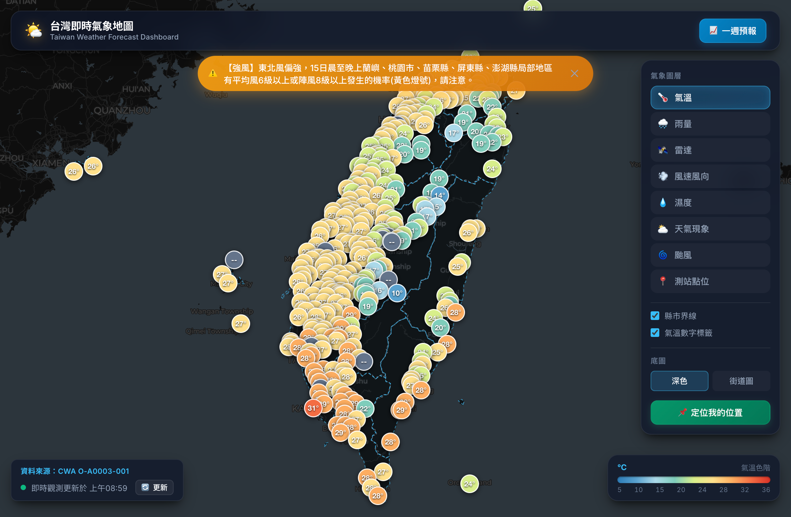

GitHub Repository: https://github.com/wilber830915/AIoT-HW1-CWA

Live Demo: https://aiot-hw1-cwa.vercel.app/



---

# 🌤️ 台灣即時氣象地圖專案

本專案結合了中央氣象署 (CWA) OpenData API、SQLite 資料庫持久化儲存，以及極具科技感的現代化深色玻璃擬態 (Glassmorphism) 全台互動式天氣地圖。

---

## 🚀 快速開始與部署

### 本機執行（SQLite 版本）
```bash
pip install -r requirements.txt
python server.py
# 開啟 http://127.0.0.1:8000
```
本機資料流：`CWA O-A0003-001` → 寫入 `data.db` → 網頁讀取 `data.db`。
若 CWA 連線失敗，會自動退回讀取資料庫既有快取。靜態網頁（`public/`）由 Flask 一併提供。

### Vercel 部署（即時 API 版本）
`vercel.json` 已設定建置與路由（`/api/*` → `server.py`，其餘 → `public/`）。
Vercel 執行環境會自動帶入 `VERCEL=1`，此時程式**跳過 SQLite**，直接使用中央氣象局即時資料（serverless 檔案系統唯讀，無法寫入資料庫）。

### Streamlit 課程示範版（可選）
```bash
streamlit run streamlit_app.py
```

---

## 🌟 核心特色與功能亮點

### 1. 類 Windy 風格全螢幕互動氣象地圖
* **8 大即時氣象圖層切換**：
  * 🌡️ **氣溫**：全台 360+ 自動觀測站彩色氣溫泡泡與數值標籤（依溫度自動色標漸層）
  * 🌧️ **雨量**：全台各站時降雨量動態半徑與強度標籤
  * 🛰️ **雷達**：整合 RainViewer 全球高精準雷達回波動態疊圖（支援 CWA 官方回波備援）
  * 💨 **風速風向**：測站風向旋轉指標與風速數值
  * 💧 **濕度**：各區相對濕度 (%) 分佈
  * ⛅ **天氣**：天氣現象動態圖示（晴、多雲、陰、雨、雷）
  * 🌀 **颱風**：即時颱風動態、中心氣壓、最大風速與路徑追蹤
  * 📍 **測站點位**：全台所有地面自動氣象觀測站
* **雙重底圖風格**：深色科技底圖 (CartoDB Dark Matter) / 街道圖 (Voyager)
* **台灣 22 縣市界線**：完整高精度向量 GeoJSON 邊界多邊形，支援滑鼠 Hover 高亮與點擊連動
* **📌 定位我的位置**：HTML5 Geolocation 自動定位並顯示最近測站氣象資訊
* **⚠️ 即時氣象特報橫幅**：連線氣象署發布之強風、豪大雨、陸上強風警報

### 2. 完整實作微課程 24 步驟核心成果
* **CWA API 資料擷取**：介接 `F-D0047-091` (一週天氣預報) 與 `O-A0003-001` (自動氣象站現在天氣觀測報告)
* **SQLite 資料庫儲存（本機）**：寫入本地 `data.db`，設計 `TemperatureForecasts`（氣溫預報）與 `StationObservations`（即時測站）兩張表；Vercel 版則直接使用 CWA 即時 API
* **一週最高溫與最低溫平滑折線圖**：採用 Chart.js 繪製雙軸漸層貝茲曲線（最高溫 MaxT 紅線 vs 最低溫 MinT 藍線）
* **預報資料表格**：清楚呈現日期、天氣概況、最低溫、最高溫、溫差與降雨機率 (PoP)
* **地區下拉選單**：支援北部、中部、南部、東部、離島與 22 個縣市快速切換連動

---

## 📂 專案架構

```text
L3_CWAv2/
├── .env.example                 # 環境變數範例 (CWA_API_KEY / CWA_BASE_URL)
├── .env.local                   # 本機 CWA API Key（不納入版控）
├── requirements.txt             # 相依套件 (Flask, flask-cors, requests, pandas, streamlit, folium…)
├── cwa_service.py               # CWA API 請求服務、記憶體快取與 JSON 解析
├── database.py                  # SQLite data.db 管理、資料表設計與 SQL 查詢
├── server.py                    # Flask Web 伺服器 (REST API + public/ 靜態網頁；本機/Vercel 自動切換)
├── streamlit_app.py             # 對照微課程海報 Step 11~19 之 Streamlit 實作版本
├── vercel.json                  # Vercel 建置與路由設定
├── data.db                      # SQLite 氣象資料庫（本機執行時自動產生，不納入版控）
├── aiot-hw1-cwa.vercel.app_.png # Live Demo 截圖
└── public/                      # 現代化前端靜態檔案
    ├── index.html               # 網頁主架構 (類 Windy 地圖 + 頂部狀態列 + 預報抽屜)
    ├── styles.css               # 現代深色玻璃擬態樣式
    ├── app.js                   # Leaflet 地圖、圖層渲染、雷達回波、Chart.js 折線圖
    └── counties.geojson         # 台灣 22 縣市精緻向量地圖圖資
```
---

## 🎓 微課程 24 步驟對應實作清單

| 海報步驟 | 課程主題 | 專案中對應實作位置 |
|---|---|---|
| **Step 3~4** | CWA API 資料取得 | `cwa_service.py` 呼叫 `O-A0003-001` 與 `F-D0047-091` |
| **Step 5~6** | JSON 解析與提取 MinT/MaxT | `cwa_service.py` 解析時間陣列並提取最低/最高氣溫 |
| **Step 7** | 資料整理與預覽 (Pandas) | `database.py` 中的 `get_forecasts_dataframe()` |
| **Step 8~9** | 建立 SQLite 資料庫與表格設計 | `database.py` 建立 `data.db` 與 `TemperatureForecasts` 表 |
| **Step 10** | 查詢資料驗證 (SQL) | `database.py` 執行 `SELECT DISTINCT regionName` 與條件查詢 |
| **Step 11~12**| Web App 入門與讀取資料庫 | `server.py` `/api/weather/forecast` 與 `streamlit_app.py` |
| **Step 13** | 下拉選單選擇地區 | 前端 `<select id="select-region">` 支援全台分區與 22 縣市 |
| **Step 14** | 繪製一週最高最低氣溫折線圖 | 前端 `app.js` 使用 Chart.js 繪製平滑漸層填充雙曲線 |
| **Step 15** | 顯示資料表格 | 前端 `index.html` 之 `<table class="forecast-table">` |
| **Step 16** | 整合 Web App 介面 | 浮動抽屜抽拉式面板與側邊彈窗整合 |
| **Step 17~19**| 台灣地圖視覺化與儀表板成果展示 | 全功能 Leaflet 類 Windy 風格地圖 + 測站標籤 + 四級溫標著色 |
| **Step 20** | 程式碼品質優化 | 包含快取重試、`INSERT OR REPLACE` 避免重複、模組化架構 |

---

## 🔌 RESTful API 端點說明

| 端點 | 方法 | 說明 |
|---|---|---|
| `/api/weather/current` | GET | 全台 360+ 測站即時觀測 GeoJSON、極端統計與連線狀態（本機由 `data.db` 讀取，Vercel 直接回 CWA `O-A0003-001`） |
| `/api/weather/forecast?region=縣市名稱` | GET | 指定縣市未來 7 天氣溫預報、降雨機率與天氣現象（本機由 `data.db` 讀取，Vercel 直接回 CWA `F-D0047-091`） |
| `/api/weather/regions` | GET | 可用縣市清單（本機讀 `data.db`；Vercel 取自 CWA 預報縣市） |
| `/api/warnings` | GET | 中央氣象署即時氣象特報與警報清單（CWA `W-C0033-001`） |
| `/api/typhoon` | GET | 即時颱風觀測路徑與暴風半徑（經外部氣象資料鏡像取得） |
| `/api/sync` | POST | 手動觸發從 CWA 更新並重新同步寫入 SQLite 資料庫（僅本機有效） |

> 註：前端目前實際呼叫的端點為 `/api/weather/current`、`/api/weather/forecast`、`/api/warnings`、`/api/typhoon`；`/api/weather/regions` 與 `/api/sync` 供外部整合使用。
